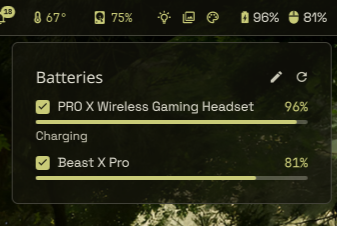

# Batteries

Wireless headset, mouse, keyboard and gamepad batteries on the QS Bar, from
UPower, headsetcontrol, or any command you point it at.



## What it does

- Shows one icon and percentage per device on the bar. The icon switches while
  a device charges and turns red at or below the low-battery threshold.
- Click it for a panel listing every device with a charge bar, a charging /
  error line, and a checkbox per device choosing what the bar shows (at least
  one always stays on).
- Works with no setup through two built-in readers:
  - **UPower**: Bluetooth headphones, Logitech HID++ mice and keyboards,
    gamepads and anything else the system already knows (the laptop battery
    and mains are skipped).
  - **headsetcontrol**: Logitech, SteelSeries, Corsair and HyperX headsets over
    their USB dongles (needs `headsetcontrol` installed).
- Anything else: write a small reader command and list it in `readers.json`.

## Install

- **QS Bar Settings -> Community -> Discover -> Batteries -> Install**, or
  `ryoku plugin add <this folder> --bar`.
- Optional: install `headsetcontrol` (AUR) for headsets that UPower can't see.

## How it plugs in

A bar plugin (`topbarGlyph` host) with a panel:

- `service/Main.qml` runs `bin/batteries` every poll, keeps the device list, and
  stores which devices the bar shows (`bar.json` in the plugin state dir).
- `content/Widget.qml` is the bar glyph; `content/Panel.qml` is the panel. Both
  only render what the service holds; a bar click only toggles the panel.
- `bin/batteries` reads `readers.json`, runs the enabled readers in parallel
  (argv, never a shell, each with a timeout), and merges their devices.
- `bin/readers/upower` and `bin/readers/headsetcontrol` are the built-ins.

## Settings

Global, in QS Bar Settings -> Community -> Batteries:

| Key           | Default                                  | Meaning                                   |
| ------------- | ---------------------------------------- | ----------------------------------------- |
| `showPercent` | `true`                                   | Show the percentage next to each icon     |
| `hideOffline` | `false`                                  | Hide devices with no reading from the bar |
| `lowPercent`  | `15`                                     | Low-battery warning threshold             |
| `pollSec`     | `60`                                     | Seconds between polls                     |
| `configPath`  | `~/.config/ryoku-batteries/readers.json` | Per-reader config file                    |

### readers.json

Per-reader options. Click the pencil in the panel to create it from a template
(only if it doesn't exist; an existing file is never modified) and open it. No
file = both built-ins. Saving it applies at once.

```json
{
  "$schema": "https://raw.githubusercontent.com/ryoku-dev/ryostore/main/plugins/batteries/schema/readers.schema.json",
  "version": 1,
  "readers": [
    { "id": "upower",         "builtin": "upower" },
    { "id": "headsetcontrol", "builtin": "headsetcontrol" },
    { "id": "kbd", "cmd": ["~/.config/ryoku-batteries/readers/my-keyboard"],
      "label": "My keyboard", "kind": "keyboard", "interval": 300, "timeout": 5 }
  ]
}
```

`$schema` gives completion and validation in VS Code, Neovim (jsonls), Zed and
Helix. The generated template points at the installed copy instead
(`file://…/plugins/batteries/schema/readers.schema.json`), which works offline.

| Field      | Meaning                                                                  |
| ---------- | ------------------------------------------------------------------------ |
| `id`       | Unique name; also keys bar visibility, so renaming it resets that        |
| `builtin`  | `upower` or `headsetcontrol`; exactly one of `builtin` / `cmd`           |
| `cmd`      | argv of your own reader, run without a shell; a leading `~` is expanded  |
| `enabled`  | `false` skips it (default `true`)                                        |
| `interval` | Seconds between runs; `0` = every poll (default)                         |
| `timeout`  | Seconds before it is killed and shown as an error (default `10`)         |
| `label`    | Display name, when the reader reports exactly one device                 |
| `kind`     | `mouse` `headset` `keyboard` `gamepad` `phone` `tablet`: picks the icon  |
| `icon`     | Any Nerd Font glyph, overriding the kind's icon                          |

A broken config, an unknown built-in, or a reader that crashes, prints bad
output or times out each shows up in the panel as an error row saying why.

### Writing a reader

Any executable that prints headsetcontrol's JSON shape on stdout:

```json
{"api_version": "1",
 "devices": [{"product": "My keyboard", "kind": "keyboard",
              "battery": {"status": "BATTERY_CHARGING", "level": 62},
              "errors": {"battery": "set only when level is -1"}}]}
```

- `battery.level`: 0-100, or -1 when unknown. Everything else is optional.
- `battery.status`: `BATTERY_CHARGING` | `BATTERY_AVAILABLE` | `BATTERY_UNAVAILABLE`.
- `headsetcontrol -o json -b` output is itself a valid reader.

## What it runs, reads and writes

- **Runs:** `bin/batteries` every poll and when the panel opens, which runs the
  enabled readers: `upower -e` / `upower -i`, `headsetcontrol -o json -b`, and
  **every `cmd` you list in readers.json, as you, unsandboxed. Only list
  commands you trust.** The pencil runs `xdg-open` on the config file.
- **Reads:** readers.json (path from `configPath`).
- **Writes:** `$XDG_STATE_HOME/ryoku/plugins/batteries/` (`bar.json`: bar
  visibility; `cache.json`: last results, for `interval`). Creates readers.json
  from the template only when you click the pencil and it doesn't exist.
- **Network:** none. **Privileged:** none. **Window manager:** none.

## Develop

```
batteries/
  manifest.json                 # id, version, entry points, settings schema
  service/Main.qml              # polls bin/batteries, holds devices + bar.json
  content/Widget.qml            # bar glyph
  content/Panel.qml             # panel: devices, checkboxes, edit, refresh
  bin/batteries                 # runs readers from readers.json, merges output
  bin/readers/upower            # built-in: UPower peripherals
  bin/readers/headsetcontrol    # built-in: headsetcontrol headsets
  schema/readers.schema.json    # JSON Schema for readers.json
  assets/preview-widget.png     # the README image
```

Self-tests: `bin/batteries --test`, `bin/readers/upower --test`.

## Credits

By l7kill. MIT-licensed. Headset support by
[HeadsetControl](https://github.com/Sapd/HeadsetControl); the reader output
format follows its JSON API.
